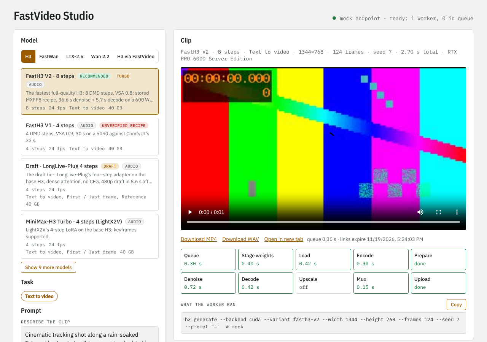

# FastVideo Studio

The web app that drives the RunPod endpoint: one page in the Prompt Studio
style (same tokens, fonts and panels as `fastwan-rs` / `h3-rs` `web/demo.html`),
its form generated from `catalog/catalog.json`, and a Cloudflare Worker that
holds the RunPod key and proxies the jobs API.

```
studio/
  worker.js          the Worker: static assets + /api/* (no framework, no npm runtime deps)
  wrangler.toml      bindings: assets (web/), R2 bucket UPLOADS, vars
  web/               the page: index.html, studio.css, js/{catalog,api,form,player,session,app}.js
  tests/             node --test unit tests, the Playwright screenshot check, the mock server
  docs/              screenshots from the mock (light, dark, phone)
```



## What the page does

- **Model** first: a segmented control of families (H3, FastWan, LTX-2.5,
  Wan 2.2, H3 via FastVideo), then the family's model cards (recommended
  first, four shown, "Show N more"; hidden models never, `verify`-flagged
  ones with an "unverified recipe" pill). Then a **task** chip the model
  supports, the **prompt** (five example chips; a negative prompt only when
  the model takes one), the task's **inputs** (drop zones for first / last
  frame, references, audio, video, draft; a finished clip from this session
  can be picked as the video or draft input), **size**, **length**, **seed**.
- **Advanced** is one disclosure listing the model's knobs at the recipe
  defaults (`catalog.knobs[k].default` overridden by `model.knob_defaults`),
  rendered by type, `when` conditions respected, "Reset to recipe".
- The **equivalent command line** (`h3 generate …`, `fastwan generate …`, or a
  `curl` against fv-serve's `/fv/v1/jobs`) is built client-side from the
  recipe and the current knobs, with a Copy button.
- **Clip**: the MP4 plays from the presigned URL when the job completes; the
  stages grid (Queue, Stage weights, Load, Encode, Prepare, Denoise n/N,
  Decode f/F, Upscale, Mux, Upload) follows the worker's `progress_update`
  stream, with seconds from `output.timings` once done; Cancel while
  running; Download MP4 / WAV (h3) / Open in new tab; the command the worker
  ran.
- **This session**: the last 24 jobs in `localStorage` (`studio.session`),
  click to reopen (re-fetched while not terminal; "expired" after
  `expires_at`). **Endpoint** under it: the last `op: info` result with a
  Refresh.
- Polling every 2 s while `IN_QUEUE` / `IN_PROGRESS`; `delayTime` shown as
  the queue wait; a 401 re-locks the page. The form (model, task, size,
  length, knobs per model, prompt) persists in `studio.form`.

## The Worker's API

| Route | Does |
|---|---|
| `GET /api/catalog` | the catalog JSON (public) |
| `GET /api/health` | RunPod `/health` passthrough: `{label, workers, jobs}` |
| `POST /api/jobs` | body = the `jobs.md` input → RunPod `/run` with `policy.executionTimeout` 30 min; `{id, status}` |
| `GET /api/jobs/:id` | RunPod `/status/:id` normalised to `{id, status, progress?, output?, error?, delayTime?, executionTime?}`; a COMPLETED job whose output is `{error, where}` is reported as `FAILED` |
| `POST /api/jobs/:id/cancel` | RunPod `/cancel/:id` |
| `POST /api/uploads` | raw body + `X-File-Name` (or multipart), ≤ 512 MiB, into R2 under `uploads/<yyyy-mm>/<random>-<name>`; `{r2, bytes, mime}` |
| `POST /api/info` | RunPod `/runsync` with `{"input": {"op": "info"}}`, 60 s timeout |

Every route but the catalog needs `Authorization: Bearer <STUDIO_TOKEN>`;
POSTs with a foreign `Origin` are refused (403); API responses carry
`Cache-Control: no-store`. The page sends images up to 6 MiB inline as
`{b64, mime}` and everything else through `/api/uploads` as `{r2}`.

## Deploy

From `studio/` (wrangler 4, no install needed):

```sh
# once: the uploads bucket (name from wrangler.toml), then the secrets
npx wrangler@4 r2 bucket create fastvideo-studio-uploads
npx wrangler@4 secret put RUNPOD_API_KEY
npx wrangler@4 secret put RUNPOD_ENDPOINT_ID
npx wrangler@4 secret put STUDIO_TOKEN        # any long random string; the page asks for it once
# for live streams on a pod (docs/pod-mode.md): the Cloudflare account id and a Stream token
npx wrangler@4 secret put CF_ACCOUNT_ID
npx wrangler@4 secret put CF_STREAM_API_TOKEN

npx wrangler@4 deploy
```

Secrets survive every deploy. Plain-text variables added in the dashboard
survive only because `wrangler.toml` sets `keep_vars = true`; without it a
deploy replaces them with the file's `[vars]`. Put tokens in secrets.

`ENDPOINT_LABEL` (a `[vars]` entry) is shown in the header next to the
status. The endpoint's worker must be able to read the `uploads/` prefix of
that bucket (the `{r2}` media form in `jobs.md`): give it the bucket's
credentials, or point `bucket_name` at the bucket the worker already reads.

Custom domain: this is a Worker with static assets, not a Pages project, so
the domain is added under the Worker's *Settings → Domains & Routes* (or
`routes = [{ pattern = "studio.example.com", custom_domain = true }]` in
`wrangler.toml`). The page is same-origin with the API, so no CORS setup is
needed.

## Run it locally against a mock

```sh
node tests/screenshot.cjs --serve [--port 4571]
```

keeps a tiny Node server up that serves `web/` and mocks `/api/*` (token
`studio-test`): a submitted job walks through the stages over ~3 s and
completes with a small real MP4 (made with ffmpeg if installed, else
`tests/fixtures/test.mp4`). For the real Worker locally: `npx wrangler@4 dev`
with the secrets in a `.dev.vars` file.

## Tests

```sh
node --test tests/*.test.mjs          # Worker (fake RunPod fetch, in-memory R2) + form helpers
node tests/screenshot.cjs             # Playwright: unlock, H3 → FastH3 V2 → t2v, generate, wait
                                      # for the clip; writes docs/screenshot-{light,dark,phone}.png
node tests/screenshot.cjs --family fastwan   # the form regenerates for FastWan (no screenshots)
node tests/screenshot.cjs --family ltx       # … and for LTX-2.5
```

The Playwright check needs Chromium available to `require("playwright")`;
it fails on page errors and on any horizontal overflow at phone width.

## Known limits

- The presigned URLs (video, audio, thumbnail) last 24 h; after that a
  session entry shows "expired" and the clip has to be generated again.
- One shared token for everyone who uses the page; no per-user accounts,
  quotas or pricing (design.md §4).
- Uploaded files are never deleted by the Studio; prune `uploads/` with an
  R2 lifecycle rule.
- The `op: info` panel renders whatever keys the worker returns; the exact
  shape is the worker's.
